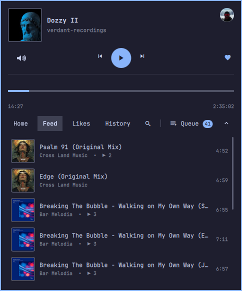
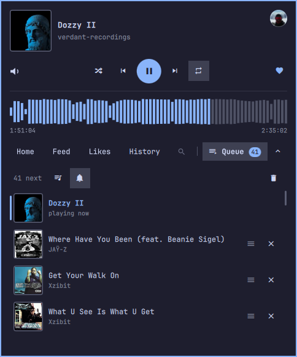

# Omarchy SoundCloud

SoundCloud playback and browsing in the Omarchy top bar, without a browser tab and without official SoundCloud API credentials.



## Features

- **Browse and play your SoundCloud** from the top bar, without a browser tab: Home, Feed, Likes and History, with a filter box to find a track quickly
- **Play queue** matching web player functionality: next, previous, repeat and shuffle work, the next track starts by itself, related tracks keep playing when the queue ends, add track to queue.
- **Play any track link:** copy a SoundCloud link and play it with one key, or paste it into the popup
- **Volume control:** change SoundCloud's volume without touching the system volume
- **Keyboard control:** use the popup without the mouse, with keyboard shortcuts, media keys and Omarchy key bindings (see [Controls](#controls))
- **Headset and earbud buttons:** play, pause and skip from your headset; on earbuds that only send Play/Pause, a double press skips to the next track
- Sign in once and stay signed in; no SoundCloud API credentials needed

## Requirements

- Omarchy 4 with `omarchy-shell`
- Python 3 with PyGObject
- GTK 3, WebKitGTK 4.1, and libsoup 3
- `gst-plugins-good` (provides WebKitGTK's required `autoaudiosink`)
- `gst-libav` (provides AAC decoding for current SoundCloud HLS streams)

A stock Omarchy install includes everything except the two GStreamer plugins. Install them if needed:

```sh
omarchy pkg add gst-plugins-good gst-libav
```

Playing a link from a key binding also needs `wl-paste` (the `wl-clipboard` package) and `notify-send` (`libnotify`). Check with `command -v wl-paste notify-send`.

If a dependency is missing, the popup names the packages to install instead of connecting. To verify all runtime dependencies from a terminal:

```sh
python3 soundcloud_app.py check
```

## Install

```sh
omarchy plugin add https://github.com/brunossilveira/omarchy-plugin-soundcloud.git --enable
```

The widget appears in the right section of the top bar. Open or close its popup from a keybinding or script with:

```sh
omarchy-shell shell toggle brunosilveira.soundcloud
```

See [Key bindings](#key-bindings) to put it on a key.

## First sign-in

1. Click the SoundCloud icon in the top bar.
2. Select `Connect`.
3. Select `Show SoundCloud sign in`.
4. Sign in inside the SoundCloud window.
5. Close the window after the account page loads.

You only need to sign in once. Closing the window hides it; the playback backend keeps running.

## Controls

**On the bar icon**

| Control | What it does |
|---|---|
| Click | Open or close the popup |
| Middle-click | Play or pause |
| Right-click | Next track |
| Scroll | Previous or next track (with the option `wheelVolume`, change the volume instead) |

In the popup, click your avatar to open your SoundCloud Library, or the cover to open the current track on SoundCloud.

**With the keyboard in the popup**

The keys of the SoundCloud web player work the same here.

*Same as the SoundCloud web player*

| Key | What it does |
|---|---|
| Space | Play or pause |
| Left / Right | Seek (5 seconds, longer while held) |
| Shift+Left / Shift+Right (or PageUp / PageDown) | Previous / next track |
| Shift+Up / Shift+Down | Volume |
| `m` | Mute |
| `l` | Like |
| Shift+L / Shift+S | Repeat / shuffle |
| `q` | Open the queue |
| `/` or Ctrl+F | Filter the list |

*Added for the popup*

| Key | What it does |
|---|---|
| Up / Down, `j` / `k` | Move the selection |
| Enter | Play the selected track |
| Tab / Shift+Tab | Switch tabs |
| Alt+Up / Alt+Down | Move a queue row |
| Ctrl+V / Ctrl+Shift+V | Add the copied SoundCloud link as play next / play it now |
| Esc | Close (in the filter field: clear it first) |

**Media keys**

The plugin is a standard Linux media player (MPRIS), so these work without any setup:

- Your keyboard's media keys and headset buttons: play, pause, next, previous, seek
- Omarchy's media widget: shows what is playing and controls it

Earbuds that only send Play/Pause get two extra gestures (untested on a real device for now):

| Gesture | What it does |
|---|---|
| Press once | Play or pause |
| Press twice within a second | Next track |
| Press three times | Previous track |

Turn this off by setting `multiPress` to `false` in `settings.json` while the backend is stopped.

## Options

Options go on the widget's entry in `~/.config/omarchy/shell.json`. The shell applies a saved change at once. The chevron in the popup saves its own choice, which wins over this option.

```json
{ "id": "brunosilveira.soundcloud", "startFolded": true, "wheelVolume": true }
```

| Option | Default | What it does |
|---|---|---|
| `startFolded` | `false` | The popup opens showing only the player and the tabs. Picking a tab, the queue or the filter opens its list, and clicking the open tab folds it again. The popup reopens as you left it (folded or showing a list). The chevron at the right of the tab row folds or shows the lists at any time, and Tab walks through "no tab open" as one stop. |
| `wheelVolume` | `false` | Scrolling over the bar icon changes SoundCloud's volume, with Omarchy's volume display showing "SoundCloud", instead of skipping tracks. |

## Key bindings

The plugin does not add key bindings itself, because Omarchy has no install hook for plugins. Add the ones you want to `~/.config/hypr/bindings.lua`. Hyprland reloads on save; check for mistakes with `hyprctl configerrors`.

| Action | Command | Example key |
|---|---|---|
| Open or close the popup | `omarchy-shell shell toggle brunosilveira.soundcloud` | `SUPER + SHIFT + M` |
| Play the track link on the clipboard | `soundcloud_app.py play-url --notify "$(wl-paste …)"` | `SUPER + SHIFT + ALT + P` |

The keys are only suggestions. See which are taken with `omarchy menu keybindings --print`. If a key is already used, call `hl.unbind` for it before binding it again.

### Open or close the popup

```lua
-- SUPER+SHIFT+M is Omarchy's default "Music" key, so unbind it first.
hl.unbind("SUPER + SHIFT + M")
o.bind("SUPER + SHIFT + M", "SoundCloud", "omarchy-shell shell toggle brunosilveira.soundcloud")
```

Use `summon` instead of `toggle` to always open the popup, or `hide` to close it.

### Play the link on the clipboard

Copy a track link, for example with "Copy link address" in your browser, then press the key:

```lua
o.bind("SUPER + SHIFT + ALT + P", "SoundCloud: play link from clipboard",
  [[python3 -I "$HOME/.config/omarchy/plugins/brunosilveira.soundcloud/soundcloud_app.py" play-url --notify "$(wl-paste --no-newline --type text)"]])
```

Options for `play-url`:

- `--notify` shows a short notification, because a key binding has no terminal to print to. It names the track ("Playing: title — artist") or says what went wrong. It also says "Starting SoundCloud…" when the backend has to start, which can take a few seconds.
- `--open` also opens the popup once the track starts. It is off by default so a paste does not cover your screen.

Without either option the command prints JSON and exits non-zero on failure, which suits scripts.

## Play a link

Copy a SoundCloud track link, for example with "Copy link address" in your browser, and play it in the plugin with:

```sh
python3 soundcloud_app.py play-url "https://soundcloud.com/artist/track"
```

To play whatever link is on the clipboard with one key, see [Key bindings](#key-bindings).

Track links work with or without `https://`, with `www.` or `m.`, and with tracking parameters such as `?si=`, which are dropped. Private track links with a secret token and `on.soundcloud.com` short links work too. Links to artists, playlists, and other SoundCloud pages are not supported yet and say so. A track that SoundCloud does not allow playing, or that is private or deleted, gives a clear message.

## Troubleshooting

- The popup reports missing packages: install them with the `omarchy pkg add` command it shows, then select Connect again.
- Nothing plays: run `python3 soundcloud_app.py check` and install any missing GStreamer plugins.
- The heart opens the SoundCloud window: SoundCloud's bot protection wants a captcha. Solve it in that window, close it, then tap the heart again.
- Lists or playback stop working: SoundCloud may have changed its private web API. Stop the backend with `python3 soundcloud_app.py stop` and open the popup again to relaunch it. If that does not help, please open an issue.
- Playback stops after a Wi-Fi drop: the plugin keeps retrying for up to 10 minutes and resumes where you were. A notification tells you when the connection is lost and when it is back.
- Some tracks never play: tracks blocked for off-platform or regional playback keep SoundCloud's normal restrictions.

## Removing

To keep the local SoundCloud session for a later reinstall, remove the plugin with:

```sh
omarchy plugin remove brunosilveira.soundcloud
```

The backend watches the installed plugin path, shuts down when it disappears, and removes its runtime socket. These owner-only files in `~/.local/share/omarchy-soundcloud/` are intentionally kept so reinstalling does not require another sign-in:

- `cookies.json`: the SoundCloud session cookies
- `tracks.json`: the cached track lists (Home, Feed, Likes, History, and the tracks you played here), with titles, artists, and links
- `settings.json`: the volume, mute, Autoplay, notification and multi-press settings
- `queue.json`: the play queue (titles, artists, links), its repeat and shuffle settings, and where you stopped in the current track

The runtime directory `$XDG_RUNTIME_DIR/omarchy-soundcloud/` (lock file and the optional `pagination.log`) is also kept until logout.

To remove persistent state too, run these commands in this order while the plugin is still installed:

```sh
python3 soundcloud_app.py stop
rm -r -- ~/.local/share/omarchy-soundcloud ~/.cache/omarchy-soundcloud
omarchy plugin remove brunosilveira.soundcloud
```

## Limitations

SoundCloud requires Artist Pro to issue official API credentials, so this plugin uses the authenticated web app's private JSON APIs through an isolated WebKit view. Selecting a track resolves its stable track ID to a short-lived media URL for the local GStreamer player. These private API schemas can change without notice.

- **History** shows what SoundCloud recorded, plus the last 50 tracks you played in this plugin. In testing, SoundCloud's history did not include tracks played here, so the plugin keeps its own list and merges it with SoundCloud's history by play time.
- Some tracks, such as many ad-supported ones, only offer DRM-encrypted streams. The plugin cannot play those, so selecting one shows an error.

## How it works

A hidden, sandboxed WebKitGTK view stays signed in to soundcloud.com. The backend reads the SoundCloud web app's own API responses to build the Home and Feed lists and to resolve stream URLs, then plays the audio locally with GStreamer. The bar widget talks to the backend over a private Unix socket.

- The backend (`soundcloud_app.py`) starts only when you interact with the widget. When the shell starts, the widget only looks for a running backend, so playback survives shell restarts.
- The backend stops when the plugin is removed, or 10 seconds after the bar widget disconnects.
- Likes and History are read by the backend straight from SoundCloud's account API (`/users/{id}/track_likes` and `/me/play-history/tracks`) with the session token, a page at a time (24), and cached like the other lists. SoundCloud does not record plays from this player, so the plugin keeps its own list of the last 50 tracks it played and merges them with SoundCloud's history by play time. The hidden page is kept on Home or Feed while they are open, because playing a track needs the request context the page records there.
- Pasted links are resolved with SoundCloud's `/resolve` API, only for soundcloud.com track pages, and then played like any list track.
- Home and Feed are built from the SoundCloud page's own API responses and paginated through SoundCloud's API cursors. Each list keeps at most 100 tracks and is cached so the popup has content right after a restart.
- Selecting a track resolves it to a short-lived stream URL inside the WebKit view. The backend then plays it with GStreamer, directly for progressive streams and through a bounded segment fetcher for HLS. A track that does not resolve within 15 seconds shows an error.
- Selecting a track in Home, Feed, Likes or History makes that list the play queue, starting at the track. Next and previous move through it (previous restarts the track after 3 seconds), a track that ends starts the next one, and a track that can't play is skipped when it was started automatically. The queue, its repeat and shuffle settings, and the playback position are saved in `~/.local/share/omarchy-soundcloud/queue.json`; after a restart the last track shows as paused where you left it, and play resumes from there.
- Play/pause and seek control GStreamer when it is playing. Otherwise they control SoundCloud's own web player. Previous and next never touch it.
- The backend registers as a standard media player (MPRIS) on the D-Bus session bus. It publishes the current title, artist, cover, position and state, and accepts play, pause, next, previous and seek from media keys, headsets and widgets. Earbuds that only send Play/Pause get double- and triple-press gestures.
- After a network drop the backend retries (after 3, 6 and 12 seconds, then every 15 seconds, for up to 10 minutes) and keeps your place, with one notification when the connection is lost and one when it is back.
- On Hyprland the backend sets `WEBKIT_DISABLE_DMABUF_RENDERER=1` to avoid WebKitGTK rendering crashes.

## Privacy and security

- Network endpoints: the hidden WebKit view loads the `soundcloud.com` web app, which makes its own `api-v2.soundcloud.com` calls and loads whatever subresources (scripts, images, analytics) SoundCloud's page includes. Top-level navigation is limited to `soundcloud.com` hosts. The Python backend itself fetches audio only from `*.sndcdn.com` and `*.soundcloud.cloud` and artwork only from `i1.sndcdn.com`, over HTTPS.
- WebKit uses an ephemeral in-memory profile and cache; it is never given a pathname to reopen for session storage.
- The session survives restarts through a bounded, owner-only cookie jar in `~/.local/share/omarchy-soundcloud/`. The account password is never stored.
- SoundCloud's request authorization headers stay inside the WebKit view. They are never passed to the backend, logged, or written to disk.
- Artwork is downloaded only from SoundCloud's `i1.sndcdn.com` CDN through a bounded HTTPS fetcher, validated as PNG or JPEG, and passed to the shell as bounded image data.
- The bar connects to the backend over a mode-0600 Unix socket in the owner-only `$XDG_RUNTIME_DIR/omarchy-soundcloud/` directory. The backend checks each client's Unix peer credentials. Status is pushed over that connection, so normal controls do not launch a new Python process.
- The MPRIS media player is on your D-Bus session bus, like any media player. Any process of your user can read what is playing and send playback commands to it; nothing else is exposed.

## Backend CLI

Run these as `python3 soundcloud_app.py <command>`.

| Command | What it does |
|---|---|
| `check` | Check the runtime dependencies (prints JSON) |
| `launch` | Start the backend and show the sign-in window |
| `status` | Print the current playback status |
| `play-pause` | Play or pause |
| `previous` / `next` | Previous or next track |
| `seek 0.5` | Seek to 50% of the track |
| `play soundcloud:tracks:123456` | Play a track by its SoundCloud id |
| `play-url <link> [--notify] [--open]` | Play a SoundCloud track link |
| `show` | Show the SoundCloud window |
| `stop` | Stop the backend |

## Install for development

```sh
ln -s "$PWD" ~/.config/omarchy/plugins/brunosilveira.soundcloud
omarchy-shell shell rescanPlugins
omarchy plugin enable brunosilveira.soundcloud --before omarchy.tray
```

The widget appears in the right section of the top bar, immediately before the system tray.

## Development

| Command | What it does |
|---|---|
| `scripts/verify.sh` | Python, Node, Qt Quick and manifest/QML checks; no desktop, no network |
| `scripts/verify.sh --ui` | Also the popup smoke test (opens the real popup) |
| `scripts/verify.sh --live` | Also read-only calls to SoundCloud's private API |

Every step prints PASS, FAIL or SKIP; a missing optional tool is a SKIP with the reason. The Python tests need `node`, which runs the injected page scripts, but no GTK or display. The Qt Quick tests need `qmltestrunner` and the manifest check needs `omarchy`.

- `--ui` (`scripts/ui-smoke.sh`) needs a running Omarchy shell, a signed-in backend with a track loaded, and `grim`, `wtype`, `tesseract` and `hyprctl`. It takes the keyboard for about 20 s, never sends Enter or media keys, restores the playback state, and is safe to skip: on a machine that cannot run it, it prints SKIP and exits 0. `--playback` adds pause, seek and mute checks.
- `--live` (`scripts/api-contract.py`) needs a signed-in session and network; it names the endpoint when SoundCloud changes an interface.
- Screen geometry is measured once by `scripts/calibrate.sh` and saved in `~/.config/omarchy-soundcloud/test-config.json` (display facts only, outside the repo). The UI scripts re-measure by themselves when monitors, scale or bar position change.
- `scripts/screenshots.sh [dir] [--blur-avatar]` takes popup screenshots (ImageMagick for the blur); `scripts/chaos-network.sh --yes` is an opt-in test that cuts the Wi-Fi.
- QML changes take effect after `omarchy-restart-shell`.
- Python changes take effect after `python3 soundcloud_app.py stop` and relaunching the backend from the bar.

## License

MIT. See [LICENSE](LICENSE).
