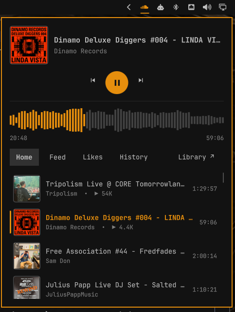
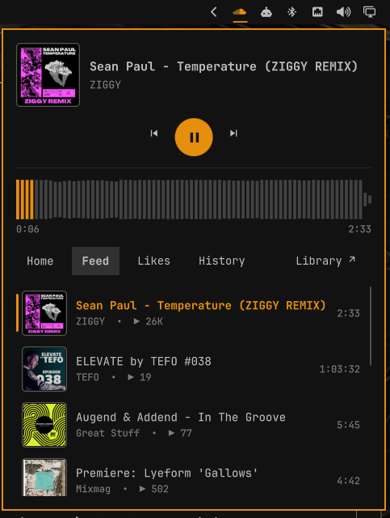

# Omarchy SoundCloud

SoundCloud playback and browsing in the Omarchy top bar, without a browser tab and
without official SoundCloud API credentials.

<p>
  
  
</p>

## Features

- Current track, artist, and artwork, with the bar icon highlighted during playback
- Play/pause, previous, and next controls, with a play queue that continues with the
  next track and survives a restart
- Volume icon in the popup: click to mute, scroll over it or hover for a slider to
  change the level. The player's own volume (not the system volume) is saved between sessions
- Keys in the popup: Up/Down or j/k move the selection, Enter plays it, Tab and
  Shift+Tab switch tabs, Space plays or pauses, Left/Right seek, PageDown or
  Shift+Right next, PageUp or Shift+Left previous, Shift+Up/Down volume, l like,
  Shift+L repeat, Shift+S shuffle, m mute, q queue, Alt+Up/Down move a queue row,
  Ctrl+V add a copied SoundCloud link as play next, Ctrl+Shift+V play it now, Esc close
- Queue button (the last stop of the tab row, with a badge counting the tracks still to
  come): shows the playing track and what follows, each row marked "added by you" when you
  queued it. Click a row, or select it and press Enter, to play it, or take it out of
  the queue with the cross. Drag the handle (or press Alt+Up/Down on the selected row) to
  reorder; the playing track stays first. A slim toolbar has shuffle, repeat and Clear, which
  asks for a confirmation first. Tab and Shift+Tab reach it after History
- Link in the clipboard while the popup is open: Ctrl+V (or SUPER+V, Shift+Insert in a
  terminal) adds it as play next, Ctrl+Shift+V plays it now; the popup names the track
  it queued
- Hover a track in a list for a menu: play, play next, add to queue. Tracks that only
  offer an encrypted stream are dimmed with a lock
- SoundCloud-style waveform progress display with click-to-seek
- Heart button to like or unlike the current track on your SoundCloud account
- Home and Feed tabs that load more tracks as you scroll
- Likes and History tabs for your account, newest first, that load more as you scroll.
  History also lists what you play here, because SoundCloud does not record it
- Play any SoundCloud track link from the clipboard with a key binding, with a
  notification naming the track
- Library arrow at the end of the tab row that opens your SoundCloud Library in the browser
- Persistent SoundCloud login session
- Local audio playback through GStreamer

## Requirements

- Omarchy 4 with `omarchy-shell`
- Python 3 with PyGObject
- GTK 3, WebKitGTK 4.1, and libsoup 3
- `gst-plugins-good` (provides WebKitGTK's required `autoaudiosink`)
- `gst-libav` (provides AAC decoding for current SoundCloud HLS streams)

A stock Omarchy install includes everything except the two GStreamer plugins.
Install them if needed:

```sh
omarchy pkg add gst-plugins-good gst-libav
```

Playing a link from a key binding also needs `wl-paste` (the `wl-clipboard` package) and
`notify-send` (`libnotify`). Check with `command -v wl-paste notify-send`.

If a dependency is missing, the popup names the packages to install instead of
connecting. To verify all runtime dependencies from a terminal:

```sh
python3 soundcloud_app.py check
```

## Install

```sh
omarchy plugin add https://github.com/brunossilveira/omarchy-plugin-soundcloud.git --enable
```

The widget appears in the right section of the top bar. Open or close its popup
from a keybinding or script with:

```sh
omarchy-shell shell toggle brunosilveira.soundcloud
```

See [Key bindings](#key-bindings) to put it on a key.

## First sign-in

1. Click the SoundCloud icon in the top bar.
2. Select `Connect`.
3. Select `Show SoundCloud sign in`.
4. Sign in inside the SoundCloud window.
5. Close the window after the account page loads.

You only need to sign in once. Closing the window hides it; the playback backend
keeps running.

## Controls

- Click: open or close the popup
- Middle-click: play/pause
- Right-click: next track
- Mouse wheel: previous/next
- Popup: artwork, metadata, playback controls, and a seekable waveform
- Home, Feed, Likes, and History tabs: click a track to play it
- Library link: opens your SoundCloud Library in the default browser

## Key bindings

The plugin does not add key bindings itself, because Omarchy has no install hook for
plugins. Add the ones you want to `~/.config/hypr/bindings.lua`. Hyprland reloads on save;
check for mistakes with `hyprctl configerrors`.

| Action | Command | Example key |
|---|---|---|
| Open or close the popup | `omarchy-shell shell toggle brunosilveira.soundcloud` | `SUPER + SHIFT + M` |
| Play the track link on the clipboard | `soundcloud_app.py play-url --notify "$(wl-paste …)"` | `SUPER + SHIFT + ALT + P` |

The keys are only suggestions. See which are taken with `omarchy menu keybindings --print`.
If a key is already used, call `hl.unbind` for it before binding it again.

### Open or close the popup

```lua
-- SUPER+SHIFT+M is Omarchy's default "Music" key, so unbind it first.
hl.unbind("SUPER + SHIFT + M")
o.bind("SUPER + SHIFT + M", "SoundCloud", "omarchy-shell shell toggle brunosilveira.soundcloud")
```

Use `summon` instead of `toggle` to always open the popup, or `hide` to close it.

### Play the link on the clipboard

Copy a track link, for example with "Copy link address" in your browser, then press the key:

```lua
o.bind("SUPER + SHIFT + ALT + P", "SoundCloud: play link from clipboard",
  [[python3 -I "$HOME/.config/omarchy/plugins/brunosilveira.soundcloud/soundcloud_app.py" play-url --notify "$(wl-paste --no-newline --type text)"]])
```

Options for `play-url`:

- `--notify` shows a short notification, because a key binding has no terminal to print to.
  It names the track ("Playing: title — artist") or says what went wrong. It also says
  "Starting SoundCloud…" when the backend has to start, which can take a few seconds.
- `--open` also opens the popup once the track starts. It is off by default so a paste does
  not cover your screen.

Without either option the command prints JSON and exits non-zero on failure, which suits
scripts.

## Play a link

Copy a SoundCloud track link, for example with "Copy link address" in your browser, and
play it in the plugin with:

```sh
python3 soundcloud_app.py play-url "https://soundcloud.com/artist/track"
```

To play whatever link is on the clipboard with one key, see [Key bindings](#key-bindings).

Track links work with or without `https://`, with `www.` or `m.`, and with tracking
parameters such as `?si=`, which are dropped. Private track links with a secret token and
`on.soundcloud.com` short links work too. Links to artists, playlists, and other
SoundCloud pages are not supported yet and say so. A track that SoundCloud does not allow
playing, or that is private or deleted, gives a clear message.

## Troubleshooting

- The popup reports missing packages: install them with the `omarchy pkg add`
  command it shows, then select Connect again.
- Nothing plays: run `python3 soundcloud_app.py check` and install any missing
  GStreamer plugins.
- The heart opens the SoundCloud window: SoundCloud's bot protection wants a
  captcha. Solve it in that window, close it, then tap the heart again.
- Lists or playback stop working: SoundCloud may have changed its private web API.
  Stop the backend with `python3 soundcloud_app.py stop` and open the popup again
  to relaunch it. If that does not help, please open an issue.
- Some tracks never play: tracks blocked for off-platform or regional playback keep
  SoundCloud's normal restrictions.

## Removing

To keep the local SoundCloud session for a later reinstall, remove the plugin with:

```sh
omarchy plugin remove brunosilveira.soundcloud
```

The backend watches the installed plugin path, shuts down when it disappears,
and removes its runtime socket. These owner-only files in
`~/.local/share/omarchy-soundcloud/` are intentionally kept so reinstalling does
not require another sign-in:

- `cookies.json`: the SoundCloud session cookies
- `tracks.json`: the cached track lists (Home, Feed, Likes, History, and the tracks you
  played here), with titles, artists, and links
- `settings.json`: the volume level and whether it is muted
- `queue.json`: the play queue (titles, artists, links), its repeat and shuffle
  settings, and where you stopped in the current track

The runtime directory `$XDG_RUNTIME_DIR/omarchy-soundcloud/` (lock file and the
optional `pagination.log`) is also kept until logout.

To remove persistent state too, run these commands in this order while the plugin
is still installed:

```sh
python3 soundcloud_app.py stop
rm -r -- ~/.local/share/omarchy-soundcloud ~/.cache/omarchy-soundcloud
omarchy plugin remove brunosilveira.soundcloud
```

## Limitations

SoundCloud requires Artist Pro to issue official API credentials, so this plugin uses
the authenticated web app's private JSON APIs through an isolated WebKit view.
Selecting a track resolves its stable track ID to a short-lived media URL for the
local GStreamer player. These private API schemas can change without notice.

- **History** shows what SoundCloud recorded, plus the last 50 tracks you played in this
  plugin. In testing, SoundCloud's history did not include tracks played here, so the plugin
  keeps its own list and merges it with SoundCloud's by play time, newest first.
- Some tracks, mostly ad-supported ones, only offer encrypted streams. The plugin cannot
  play those, so selecting one shows an error.

## How it works

A hidden, sandboxed WebKitGTK view stays signed in to soundcloud.com. The backend
reads the SoundCloud web app's own API responses to build the Home and Feed lists
and to resolve stream URLs, then plays the audio locally with GStreamer. The bar
widget talks to the backend over a private Unix socket.

- The backend (`soundcloud_app.py`) starts only when you interact with the widget.
  When the shell starts, the widget only looks for a running backend, so playback
  survives shell restarts.
- The backend stops when the plugin is removed, or 10 seconds after the bar widget
  disconnects.
- Likes and History are read by the backend straight from SoundCloud's account API
  (`/users/{id}/track_likes` and `/me/play-history/tracks`) with the session token, a
  page at a time (24), and cached like the other lists. SoundCloud does not record plays
  from this player, so the plugin keeps its own list of the last 50 tracks it played and
  merges them into SoundCloud's history by play time. The hidden page is kept on Home or Feed
  while they are open, because playing a track needs the request context the page records
  there.
- Pasted links are resolved with SoundCloud's `/resolve` API, only for soundcloud.com
  track pages, and then played like any list track.
- Home and Feed are built from the SoundCloud page's own API responses and
  paginated through SoundCloud's API cursors. Each list keeps at most 100 tracks
  and is cached so the popup has content right after a restart.
- Selecting a track resolves it to a short-lived stream URL inside the WebKit view.
  The backend then plays it with GStreamer, directly for progressive streams and
  through a bounded segment fetcher for HLS. A track that does not resolve within
  15 seconds shows an error.
- Selecting a track in Home, Feed, Likes or History makes that list the play queue,
  starting at the track. Next and previous move through it (previous restarts the
  track after 3 seconds), a track that ends starts the next one, and a track that
  can't play is skipped when it was started automatically. The queue, its repeat
  and shuffle settings, and the playback position are saved in
  `~/.local/share/omarchy-soundcloud/queue.json`; after a restart the last track
  shows as paused where you left it, and play resumes from there.
- Play/pause and seek control GStreamer when it is playing. Otherwise they control
  SoundCloud's own web player. Previous and next never touch it.
- On Hyprland the backend sets `WEBKIT_DISABLE_DMABUF_RENDERER=1` to avoid
  WebKitGTK rendering crashes.

## Privacy and security

- Network endpoints: the hidden WebKit view loads the `soundcloud.com` web app,
  which makes its own `api-v2.soundcloud.com` calls and loads whatever
  subresources (scripts, images, analytics) SoundCloud's page includes. Top-level
  navigation is limited to `soundcloud.com` hosts. The Python backend itself
  fetches audio only from `*.sndcdn.com` and `*.soundcloud.cloud` and artwork only
  from `i1.sndcdn.com`, over HTTPS.
- WebKit uses an ephemeral in-memory profile and cache; it is never given a
  pathname to reopen for session storage.
- The session survives restarts through a bounded, owner-only cookie jar in
  `~/.local/share/omarchy-soundcloud/`. The account password is never stored.
- SoundCloud's request authorization headers stay inside the WebKit view. They
  are never passed to the backend, logged, or written to disk.
- Artwork is downloaded only from SoundCloud's `i1.sndcdn.com` CDN through a
  bounded HTTPS fetcher, validated as PNG or JPEG, and passed to the shell as
  bounded image data.
- The bar connects to the backend over a mode-0600 Unix socket in the owner-only
  `$XDG_RUNTIME_DIR/omarchy-soundcloud/` directory. The backend checks each
  client's Unix peer credentials. Status is pushed over that connection, so normal
  controls do not launch a new Python process.

## Backend CLI

```sh
python3 soundcloud_app.py check        # check runtime dependencies (JSON)
python3 soundcloud_app.py launch       # start the backend and show the sign-in window
python3 soundcloud_app.py status
python3 soundcloud_app.py play-pause
python3 soundcloud_app.py previous
python3 soundcloud_app.py next
python3 soundcloud_app.py seek 0.5     # seek to 50%
python3 soundcloud_app.py play soundcloud:tracks:123456
python3 soundcloud_app.py play-url <link> [--notify] [--open]   # play a SoundCloud track link
python3 soundcloud_app.py show         # show the SoundCloud window
python3 soundcloud_app.py stop
```

## Install for development

```sh
ln -s "$PWD" ~/.config/omarchy/plugins/brunosilveira.soundcloud
omarchy-shell shell rescanPlugins
omarchy plugin enable brunosilveira.soundcloud --before omarchy.tray
```

The widget appears in the right section of the top bar, immediately before the system tray.

## Development

Run every check with one command, from any directory:

```sh
scripts/verify.sh
```

It runs the Python and Node tests, `omarchy plugin validate .`, a QML syntax
check of every `.qml` file (`qmllint`, errors only) and the Qt Quick tests in
`tests/qml/`. It prints a PASS, FAIL or SKIP line per step (a missing `omarchy`,
`qmllint` or `qmltestrunner` is skipped) and exits non-zero if a step fails.
To run a single suite:

```sh
python3 -m unittest tests/test_soundcloud_app.py -v
node tests/test_soundcloud_model.js
omarchy plugin validate .
QT_QPA_PLATFORM=offscreen qmltestrunner -input tests/qml
```

The Python tests need `node`, which runs the injected page scripts. They do not
need GTK or a display.

- QML changes take effect after `omarchy-restart-shell`.
- Python changes take effect after `python3 soundcloud_app.py stop` and relaunching
  the backend from the bar.

## License

MIT. See [LICENSE](LICENSE).
